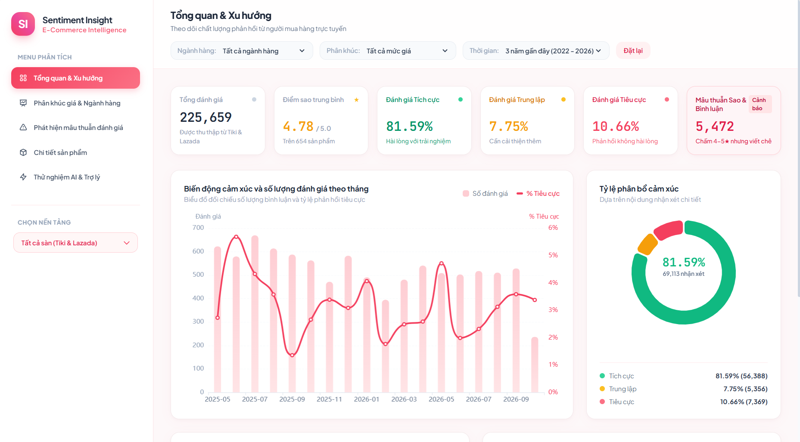
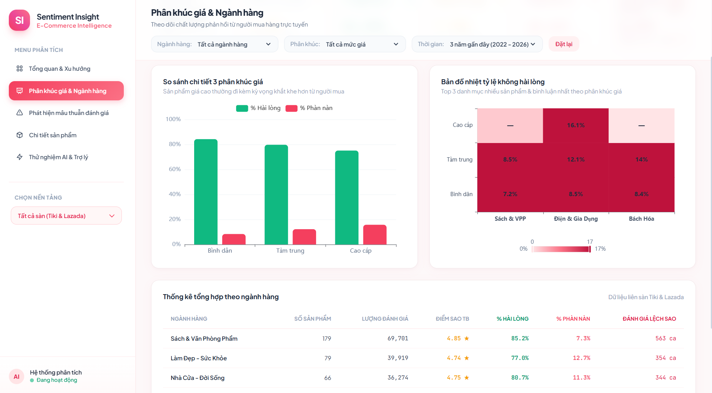
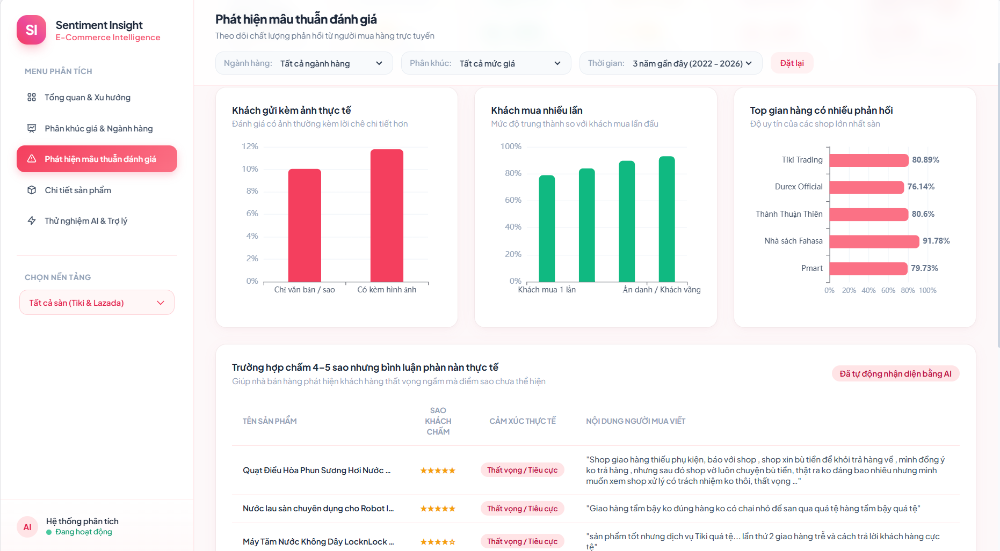
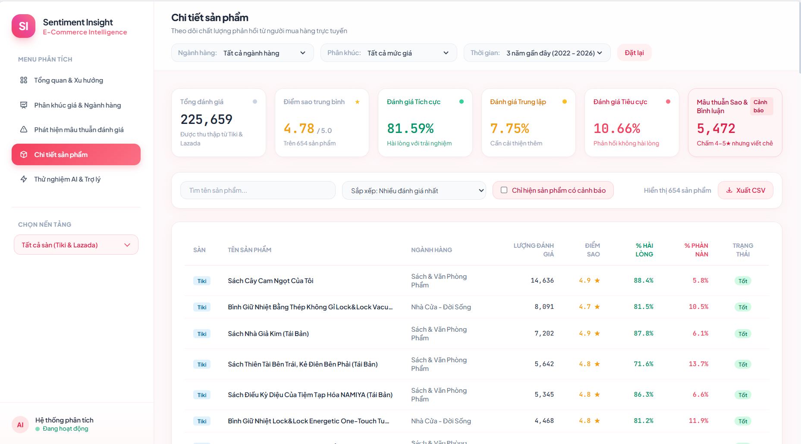
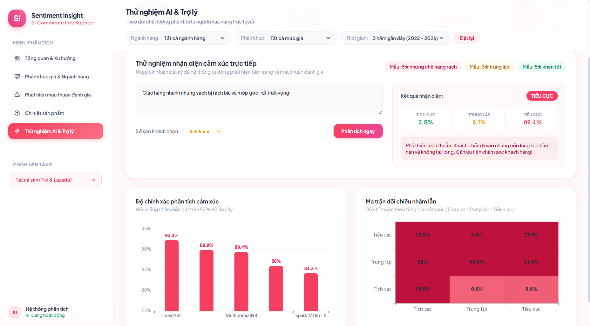

# E-Commerce Sentiment Intelligence — Tiki & Lazada Analytics

[](https://www.python.org/)
[](https://spark.apache.org/)
[](https://fastapi.tiangolo.com/)
[](https://scikit-learn.org/)
[](https://opensource.org/licenses/MIT)
[](#dataset)

An end-to-end Big Data and NLP Lakehouse system that ingests, cleans, analyzes, and visualizes customer sentiments across Vietnamese e-commerce platforms (Tiki & Lazada). The system features a Medallion Architecture (`Bronze → Silver → Gold`), a `Teacher-Student` hybrid labeling framework (`PhoBERT + Gemini → LinearSVC & Spark MLlib`) for star-versus-text conflict resolution, and an interactive Semantic BI Dashboard.

---

## Demo & Screenshots

The interactive BI Dashboard provides a comprehensive, 5-tab analytical workspace designed for e-commerce sentiment intelligence:

### 1. Overview & Trends (Tổng quan & Xu hướng)
Executive KPI summary cards, monthly sentiment time series, positive/neutral/negative volume breakdowns, and cross-platform benchmarks.


### 2. Price Tiers & Categories (Phân khúc giá & Ngành hàng)
In-depth cross-sectional analysis across 3 price tiers (`< 200k`, `200k - 1.5M`, `> 1.5M`) and 7 merchandise categories, demonstrating that customer complaints increase significantly as product prices rise.


### 3. Review Conflict Detection (Phát hiện mâu thuẫn đánh giá)
Identifies reviews with paradoxical ratings (e.g., 4–5 stars accompanied by severe negative criticism), photo attachment rates, and verified buyer distributions.


### 4. Product Details & Anomaly Drill-Down (Chi tiết sản phẩm)
Product-level search and filtering, anomaly alerts (69 flagged products), CSV report export, and interactive modal review inspection.


### 5. Live AI Sentiment Sandbox & Assistant (Thử nghiệm AI & Trợ lý)
Interactive real-time inference playground allowing users to test any custom Vietnamese sentence and rating to evaluate the LinearSVC classification engine and contradiction detection logic.


---

## Features

- **Multi-Platform Automated Ingestion**: Discovers seed products across 7 main categories and crawls reviews on Tiki and Lazada with auto-resume and anti-bot mitigation.
- **Lakehouse Medallion Pipeline (PySpark)**:
  - **Bronze**: Preserves raw ingestion data (`225,659` reviews).
  - **Silver**: Performs distributed text normalization (Unicode NFC, safe emoji/emoticon preservation), schema validation, multi-platform deduplication, and automated Data Quality Gates (`dq_report.json`).
  - **Gold**: Generates dimension and fact tables, pre-aggregates 5 analytical data marts, and supports MongoDB synchronization.
- **Text-First Hybrid Labeling & Noise Reduction**:
  - Leverages deep language models (**PhoBERT** and **Google Gemini**) as high-precision *Teachers* on text-bearing reviews.
  - Automatically flags **5,419 star-versus-text conflicts** (including **1,778 high-star false positives**: customers leaving 4–5 stars while complaining about defective items or late delivery).
  - Filters gibberish and spam comments before model training.
- **Leak-Free Machine Learning Pipeline**:
  - Deduplicates normalized review texts prior to splitting (yielding **63,090 distinct text samples** partitioned into 50,472 Train / 12,618 Test) to prevent data leakage.
  - Trains and benchmarks multiple classification engines: Scikit-learn (`LinearSVC`, `LogisticRegression`, `MultinomialNB`, `ComplementNB`) and Apache Spark MLlib (Distributed).
- **Price Tier & Category Intelligence**: Overcomes the lack of historical transaction prices by categorizing products into 3 Snapshot Price Tiers (`< 200k`, `200k - 1.5M`, `> 1.5M`), discovering actionable complaint rate trends.
- **Semantic BI Dashboard & Live Sandbox**:
  - Built with FastAPI and Apache ECharts 5 with a responsive, modern interface.
  - In-Memory OLAP fallback engine ensuring instantaneous response without requiring external database services.
  - Integrated Live AI testing tab to verify custom sentences and conflicting star ratings in real time.

---

## Tech Stack

| Domain | Technologies & Libraries |
| :--- | :--- |
| **Languages & Core** | Python 3.10+, Java 8/11/17 (for PySpark) |
| **Big Data & Processing** | Apache Spark (PySpark 3.5), PyArrow, Pandas, NumPy |
| **Machine Learning & NLP** | Scikit-learn, PyTorch, Hugging Face Transformers (`wonrax/phobert-base-vietnamese-sentiment`), Google Gemini API |
| **Data Ingestion** | Requests, Fake-UserAgent, BeautifulSoup4, Playwright |
| **Serving & Visualization** | FastAPI, Uvicorn, ECharts 5, TailwindCSS, HTML5/CSS3 |
| **Orchestration & Database** | Apache Airflow (DAGs included), MongoDB (Optional Governed Semantic Layer) |

---

## Installation

### 1. Clone the repository
```bash
git clone https://github.com/Tienndat2306/Sentiment_Analysis_of_Online_Product_Reviews.git
cd Sentiment_Analysis_of_Online_Product_Reviews
```

### 2. Set up Python virtual environment
```bash
# Windows PowerShell:
python -m venv .venv
.venv\Scripts\Activate.ps1

# Linux / macOS:
python3 -m venv .venv
source .venv/bin/activate
```

### 3. Install dependencies
```bash
pip install --upgrade pip
pip install -r requirements.txt
```

### 4. Environment Variables Setup (Optional)
If you wish to use the Gemini Verifier or synchronize data to MongoDB, create a `.env` file in the root directory:
```env
# Optional: Google Gemini API Key for semantic verification
GEMINI_API_KEY=your_gemini_api_key_here

# Optional: MongoDB Connection
MONGO_URI=mongodb://localhost:27017/
MONGO_DB=ecommerce_sentiment
```

> **Note on Apache Spark**: PySpark runs locally using Java. Ensure `JAVA_HOME` is installed and properly configured in your system environment variables.

---

## Usage

### Option 1: Launch the BI Dashboard & Live AI Sandbox (Recommended)
Pre-computed Silver/Gold datasets and the trained best model are already available in the repository. You can launch the dashboard immediately:
```bash
python src/dashboard/app.py
```
* The application will start and automatically open in your default browser at: **`http://127.0.0.1:8501`**
* The server includes:
  - **Overview & Trends**: Metric KPIs, monthly volume/sentiment distribution, platform shares.
  - **Price Tiers & Categories**: Cross-sectional analysis across 7 categories and 3 budget tiers.
  - **Conflict Analysis**: Reviews with 4-5 stars but severe negative text, image-attached review shares.
  - **Product Drill-Down**: Interactive search, anomaly alerts (69 products flagged), and modal review inspection.
  - **Live AI Sandbox**: Real-time sentiment classification and conflict diagnosis.

---

### Option 2: Run the Full End-to-End Pipeline
You can re-run the entire pipeline using the local orchestrator (`src/run_pipeline.py`), which mirrors the Airflow DAG specifications:

```bash
# Fast-track pipeline run (Silver ETL -> DQ Gate -> Gold Inference -> Gold Trends Aggregation):
python src/run_pipeline.py --skip-train

# Complete pipeline run (including model re-training on Scikit-learn & Spark MLlib):
python src/run_pipeline.py

# Complete pipeline and immediately launch the BI Dashboard upon finish:
python src/run_pipeline.py --launch-dashboard
```

---

### Option 3: Step-by-Step Execution

1. **Ingestion & Discovery**:
   ```bash
   python src/crawler/product_discovery.py --source tiki
   python src/crawler/crawler.py --from-seeds data/seeds/products.jsonl --max-pages 5
   ```

2. **PySpark Silver ETL & Data Quality Gate**:
   ```bash
   python src/spark_jobs/etl_silver.py
   ```

3. **Feature Engineering (TF-IDF & Leak-Free Train/Test Split)**:
   ```bash
   python src/spark_jobs/feature_engineering.py
   ```

4. **Model Training & Evaluation**:
   ```bash
   python src/spark_jobs/train_model.py
   python src/spark_jobs/train_spark_mllib.py
   python src/spark_jobs/evaluate_model.py
   ```

5. **Gold Inference & Marts Aggregation**:
   ```bash
   python src/spark_jobs/inference.py
   python src/spark_jobs/aggregate_trends.py
   ```

---

### Option 4: API Usage Example
You can query the sentiment prediction endpoint directly via HTTP POST:

```bash
curl -X POST "http://127.0.0.1:8501/api/sandbox/predict" \
     -H "Content-Type: application/json" \
     -d '{"text": "Đóng gói đẹp nhưng máy giao bị lỗi nguồn không khởi động được", "rating": 5}'
```

**Response Output:**
```json
{
  "predicted_label": "negative",
  "confidence": 0.8842,
  "is_conflict": true,
  "conflict_reason": "High Star (5) with Negative Text Content",
  "probabilities": {
    "negative": 0.8842,
    "neutral": 0.0812,
    "positive": 0.0346
  }
}
```

---

## Project Structure

```text
.
├── airflow/
│   └── dags/
│       ├── dag_de.py                   # Airflow DAG 1: Data Engineering Pipeline (01:00 AM)
│       └── dag_ds.py                   # Airflow DAG 2: Data Science & Gold BI Pipeline (02:00 AM)
├── configs/
│   ├── categories.yaml                 # Product category URLs and crawler parameters
│   └── settings.yaml                   # Global Lakehouse paths, Spark, ML, and DB settings
├── data/
│   ├── seeds/products.jsonl            # 654 seed products with pricing & metadata
│   ├── bronze/                         # Raw crawled reviews (tiki_reviews.csv, lazada_reviews.csv)
│   ├── silver/
│   │   ├── reviews.parquet             # Cleaned, deduplicated, schema-validated reviews (225,659 rows)
│   │   ├── teacher_annotations.parquet # High-confidence PhoBERT + Gemini teacher labels (69,113 rows)
│   │   └── dq_report.json              # Automated Data Quality validation report
│   └── gold/
│       ├── gold_reviews.parquet        # Master fact table with sentiment predictions (225,659 rows)
│       ├── train_test_split.parquet    # Leak-free Train/Test dataset (63,090 distinct samples)
│       ├── trends_by_product.parquet   # Mart 1: Product-level trend metrics (654 products)
│       ├── trends_by_time.parquet      # Mart 2: Monthly and weekly sentiment time series
│       ├── trends_by_customer.parquet  # Mart 3: Verified purchase, photos, repeat buyer behaviors
│       ├── trends_by_price_tier.parquet# Mart 4: Budget, Mid-range, and Premium tier trends
│       ├── trends_by_category.parquet  # Mart 5: Cross-platform performance by 7 categories
│       └── trends_summary_report.json  # Comprehensive summary of analytical insights
├── docs/
│   ├── anfra_dashboard_guide.md        # Guide on Anfra BI-as-Code & Semantic Layer architecture
│   └── lazada_crawler_limitations.md   # Technical analysis of Lazada anti-bot defense (Baxia)
├── models/
│   ├── best_sentiment_model.joblib     # Production TF-IDF + Calibrated LinearSVC pipeline
│   ├── metadata.json                   # Model registry tracking experiment parameters and metrics
│   ├── evaluation_report.json          # F1-Macro, confusion matrix, and per-class metrics
│   ├── spark_mllib_evaluation.json     # Distributed Spark MLlib benchmark report
│   └── spark_mllib_pipeline/           # Exported native Spark MLlib pipeline stages
├── src/
│   ├── crawler/                        # Ingestion discovery, anti-bot bypass, and review crawling
│   ├── spark_jobs/                     # PySpark ETL, Feature Engineering, Training, Inference & Aggs
│   ├── dashboard/
│   │   ├── app.py                      # FastAPI server with In-Memory Semantic OLAP engine
│   │   ├── templates/index.html        # HTML5 single-page application (Minimalist Rose UI)
│   │   └── static/                     # Assets: css/dashboard.css & js/dashboard.js
│   └── run_pipeline.py                 # Local end-to-end multi-stage pipeline orchestrator
├── IMPLEMENTATION_PLAN.md              # Detailed project milestone tracking
├── requirements.txt                    # Project dependencies
└── README.md                           # Project documentation
```

---

## Results & Model Evaluation

Models were evaluated on a dedicated, leak-free holdout test set consisting of **12,618 unseen review texts**. The primary evaluation metric is **Macro-F1** due to the natural class imbalance of real-world e-commerce reviews (predominantly 5-star positive feedback).

### Model Performance Comparison

| Model Architecture | Framework | Accuracy | Macro-F1 | Weighted-F1 | Inference Speed | Notes |
| :--- | :--- | :---: | :---: | :---: | :---: | :--- |
| **LinearSVC (Balanced, Calibrated)** | **Scikit-learn** | **92.33%** | **0.7845** | **0.9182** | Fast (< 1ms) | **Best Model (Selected)** |
| LogisticRegression (Balanced) | Scikit-learn | 89.86% | 0.7746 | 0.9061 | Fast (< 1ms) | Strong baseline |
| MultinomialNB (Baseline) | Scikit-learn | 89.40% | 0.6913 | 0.8803 | Very Fast | Biased towards positive class |
| ComplementNB (Imbalanced-tuned) | Scikit-learn | 86.00% | 0.6776 | 0.8657 | Very Fast | High recall on minority class |
| LogisticRegression (Balanced) | **Spark MLlib** | 84.17% | 0.6701 | 0.8536 | Scalable | Distributed execution |
| NaiveBayes | **Spark MLlib** | 78.46% | 0.6076 | 0.8087 | Scalable | Distributed baseline |

### Best Model Detailed Metrics (`LinearSVC (Calibrated)`)

* **Total Test Samples**: 12,618
* **Macro-Averaged Precision**: 0.8268 | **Recall**: 0.7562 | **F1-Score**: **0.7845**

| Class | Precision | Recall | F1-Score | Support |
| :--- | :---: | :---: | :---: | :---: |
| **Negative** | 0.7959 | 0.7762 | **0.7859** | 1,452 |
| **Neutral** | 0.7305 | 0.5042 | **0.5966** | 1,059 |
| **Positive** | 0.9540 | 0.9883 | **0.9708** | 10,107 |

### Confusion Matrix

```text
                 Predicted Negative   Predicted Neutral   Predicted Positive
Actual Negative         1,127                139                 186
Actual Neutral           229                 534                 296
Actual Positive           60                  58               9,989
```

### Key Business Insights Discovered
1. **Star-Rating Paradox**: Out of 69,113 reviews with descriptive text, **5,419 reviews (7.84%)** had conflicting ratings, of which **1,778 reviews** gave 4 or 5 stars but contained severe customer complaints.
2. **Price Tier Sensitivity**: As price increases, customer scrutiny rises dramatically:
   - **Budget Tier (`< 200k VND`)**: Complaint rate = `8.37%` | Conflict rate = `7.38%`
   - **Mid-Range Tier (`200k - 1.5M VND`)**: Complaint rate = `12.23%` | Conflict rate = `8.24%`
   - **Premium Tier (`> 1.5M VND`)**: Complaint rate = `15.76%` | Conflict rate = `9.65%`

---

## Dataset

- **Source**: Public e-commerce product reviews from [Tiki](https://tiki.vn) and [Lazada](https://www.lazada.vn).
- **Scale**:
  - Total Raw Records: **225,659 reviews**
  - Text-Usable Reviews: **69,113 reviews** (having content length $\ge 3$ words)
  - Monitored Seed Products: **654 products** across **7 product category groups**
- **Storage Format**:
  - Raw / Bronze: CSV format
  - Cleaned Silver & Gold: Apache Parquet (Snappy compressed) for query performance and disk efficiency.

---

## License

This project is licensed under the **MIT License** — see the [LICENSE](LICENSE) file for details.

---

## Author & Contact

- **Author**: Nguyen Tien Dat (Tienndat2306)
- **Email**: [dattrithuc123@gmail.com](mailto:dattrithuc123@gmail.com)
- **GitHub**: [@Tienndat2306](https://github.com/Tienndat2306)
- **LinkedIn**: [Nguyen Tien Dat](https://www.linkedin.com/in/nguyen-tien-dat)
