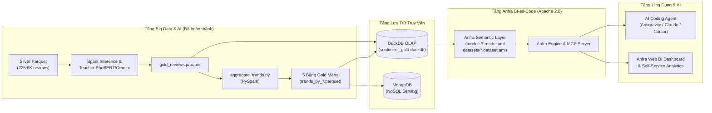

# Hướng Dẫn Phát Triển & Tích Hợp Anfra (BI-as-Code & Semantic Layer) Cho Dự Án Phân Tích Cảm Xúc

> **Mục tiêu tài liệu**: Tài liệu này định hướng kiến trúc và cung cấp hướng dẫn kỹ thuật chi tiết để nâng cấp tầng BI/Visualization của dự án **Phân tích cảm xúc đánh giá sản phẩm trực tuyến (Tiki & Lazada)** lên **Anfra** (`holistics/anfra` — nền tảng Open-source Apache 2.0 BI-as-Code & Headless Semantic Layer cho AI Coding Agents).

---

## 1. Tổng Quan Về Anfra & Lý Do Phù Hợp Với Dự Án

### 1.1. Anfra là gì?
**Anfra** (phát triển bởi đội ngũ Holistics, giấy phép mã nguồn mở **Apache 2.0**) là một nền tảng **Headless BI & Semantic Layer** được thiết kế theo triết lý **BI-as-Code** kết hợp chặt chẽ với **AI Coding Agents** (như Antigravity, Claude Code, Cursor) thông qua giao thức **MCP (Model Context Protocol)**.

Thay vì kéo-thả biểu đồ thủ công hay để AI sinh câu lệnh SQL/Pandas tự do dễ sai lệch số liệu, Anfra tách biệt thành 2 lớp rõ ràng:
1. **Tầng Ngữ Nghĩa Được Kiểm Soát (Governed Semantic Layer - `.aml`)**: Định nghĩa các bảng dữ liệu (`Model`), mối quan hệ (`Relationship`), chiều phân tích (`Dimension`) và chỉ số nghiệp vụ (`Metric`) bằng ngôn ngữ **AML (Analytics Modeling Language)**.
2. **Tầng Giao Diện & AI Agent (AI-Native Presentation Layer)**: AI Agent gọi trực tiếp vào **Anfra MCP Server** để truy vấn đúng các Metric đã được chuẩn hóa và tự động dựng giao diện Dashboard (React / Tailwind / ECharts / Next.js) hoặc trả lời câu hỏi phân tích dữ liệu (Text-to-Analytics) với độ chính xác 100%.

### 1.2. Tại sao kiến trúc hiện tại (`src/dashboard/app.py`) đã sẵn sàng cho Anfra?
Trong phiên bản hiện tại, chúng ta đã thiết kế [src/dashboard/app.py](file:///D:/Big_Data/Sentiment_Analysis_of_Online_Product_Reviews/src/dashboard/app.py) và [src/dashboard/templates/index.html](file:///D:/Big_Data/Sentiment_Analysis_of_Online_Product_Reviews/src/dashboard/templates/index.html) theo đúng **kiến trúc chuẩn của Anfra**:
- **Dữ liệu đầu vào (Gold Layer)** đã được chuẩn hóa thành 6 bảng Parquet tại `data/gold/` (Star Schema thu nhỏ):
  - Bảng Fact chi tiết: `gold_reviews.parquet` (225,659 dòng)
  - 5 bảng Data Mart tổng hợp: `trends_by_product.parquet`, `trends_by_time.parquet`, `trends_by_customer.parquet`, `trends_by_price_tier.parquet`, `trends_by_category.parquet`.
- **Tách biệt Semantic API & Giao diện**: Backend cung cấp các Metric chuẩn hóa (`negative_text_pct`, `conflict_pct`, `anomaly_product_count`) và Frontend chỉ làm nhiệm vụ hiển thị.

---

## 2. Kiến Trúc Tích Hợp Anfra Vào Hệ Thống Big Data Hiện Tại

Anfra cần một **SQL OLAP Engine** để biên dịch ngôn ngữ AML thành truy vấn SQL tốc độ cao. Vì tầng Gold của dự án đang lưu dưới dạng **Apache Parquet**, mảnh ghép hoàn hảo và nhẹ nhất (Zero-Server) để nối Parquet với Anfra chính là **DuckDB**.



---

## 3. Lộ Trình 4 Bước Triển Khai Anfra Cho Dự Án Này

Khi bạn muốn chuyển đổi hoặc mở rộng sang chạy **Anfra Engine nguyên bản**, hãy thực hiện tuần tự 4 bước dưới đây.

### Bước 1: Tạo DuckDB Database kết nối trực tiếp tới các file Gold Parquet

DuckDB có thể đọc trực tiếp file `.parquet` của PySpark mà không cần copy dữ liệu (thông qua `VIEW`), giúp tiết kiệm 100% dung lượng ổ cứng và tự động cập nhật khi bạn chạy lại PySpark.

1. Cài đặt DuckDB trong môi trường Python của dự án:
   ```powershell
   pip install duckdb
   ```
2. Chạy script khởi tạo file `data/gold/sentiment_gold.duckdb`:
   ```python
   # scripts/init_duckdb_for_anfra.py
   import duckdb
   from pathlib import Path

   gold_dir = Path("data/gold").resolve()
   db_path = gold_dir / "sentiment_gold.duckdb"

   con = duckdb.connect(str(db_path))

   views = [
       "gold_reviews",
       "trends_by_product",
       "trends_by_time",
       "trends_by_customer",
       "trends_by_price_tier",
       "trends_by_category",
   ]

   for v in views:
       parquet_path = (gold_dir / f"{v}.parquet").as_posix()
       con.execute(f"CREATE OR REPLACE VIEW {v} AS SELECT * FROM read_parquet('{parquet_path}');")
       count = con.execute(f"SELECT COUNT(*) FROM {v}").fetchone()[0]
       print(f"[OK] View '{v}' -> {count:,} rows")

   con.close()
   ```

---

### Bước 2: Khởi tạo dự án Anfra & Cấu hình kết nối (`data_sources.yml`)

Tạo thư mục `anfra_bi/` ngay trong thư mục gốc của dự án:

```text
Sentiment_Analysis_of_Online_Product_Reviews/
├── anfra_bi/
│   ├── .anfra/
│   │   └── data_sources.yml       # Kết nối vào sentiment_gold.duckdb
│   ├── models/
│   │   ├── gold_reviews.model.aml
│   │   ├── trends_by_product.model.aml
│   │   ├── trends_by_time.model.aml
│   │   └── trends_by_price_tier.model.aml
│   ├── datasets/
│   │   └── ecommerce_sentiment.dataset.aml
│   └── dashboards/
│       └── executive_overview.page.aml
```

Nội dung file `anfra_bi/.anfra/data_sources.yml`:
```yaml
data_sources:
  - name: sentiment_duckdb
    type: duckdb
    config:
      database_path: "../../data/gold/sentiment_gold.duckdb"
      read_only: true
```

---

### Bước 3: Định nghĩa Tầng Ngữ Nghĩa (Semantic Layer) bằng ngôn ngữ `.aml`

Đây là trái tim của Anfra. Thay vì phải nhớ công thức tính `% Tiêu cực thực chất trên bình luận có chữ` hay `% Mâu thuẫn Sao - Chữ` ở nhiều file Python/SQL khác nhau, bạn định nghĩa **một lần duy nhất** trong `.aml`.

#### 3.1. Model chi tiết cấp độ Review (`anfra_bi/models/gold_reviews.model.aml`)
```aml
Model gold_reviews {
  type: 'table'
  table_name: 'gold_reviews'
  data_source_name: 'sentiment_duckdb'

  dimension review_id {
    label: 'Mã Đánh Giá'
    type: 'text'
    primary_key: true
    definition: @sql {{ #SOURCE.review_id }};
  }

  dimension product_id {
    label: 'Mã Sản Phẩm'
    type: 'text'
    definition: @sql {{ #SOURCE.product_id }};
  }

  dimension source {
    label: 'Sàn TMĐT'
    type: 'text'
    definition: @sql {{ UPPER(#SOURCE.source) }};
  }

  dimension price_tier {
    label: 'Phân Khúc Giá'
    type: 'text'
    definition: @sql {{ #SOURCE.price_tier }};
  }

  dimension rating {
    label: 'Số Sao (1-5)'
    type: 'number'
    definition: @sql {{ #SOURCE.rating }};
  }

  dimension sentiment_label {
    label: 'Nhãn Cảm Xúc AI'
    type: 'text'
    definition: @sql {{ #SOURCE.sentiment_label }};
  }

  dimension has_text {
    label: 'Có Nội Dung Bình Luận'
    type: 'truefalse'
    definition: @sql {{ #SOURCE.has_text }};
  }

  dimension is_conflict {
    label: 'Mâu Thuẫn Sao - Chữ'
    type: 'truefalse'
    definition: @sql {{ #SOURCE.is_conflict }};
  }

  dimension is_noisy {
    label: 'Review Spam / Nhiễu'
    type: 'truefalse'
    definition: @sql {{ #SOURCE.is_noisy }};
  }

  dimension review_date {
    label: 'Ngày Đánh Giá'
    type: 'date'
    definition: @sql {{ CAST(#SOURCE.review_date AS DATE) }};
  }

  // --- GOVERNED METRICS (Chỉ số chuẩn hóa) ---
  measure total_reviews {
    label: 'Tổng Số Đánh Giá'
    type: 'number'
    definition: @sql {{ COUNT(#SOURCE.review_id) }};
  }

  measure text_reviews_count {
    label: 'Số Đánh Giá Có Chữ (Sạch)'
    type: 'number'
    definition: @sql {{ COUNT(CASE WHEN #SOURCE.has_text = true AND #SOURCE.is_noisy = false THEN 1 END) }};
  }

  measure avg_star_rating {
    label: 'Điểm Sao Trung Bình'
    type: 'number'
    definition: @sql {{ ROUND(AVG(#SOURCE.rating), 2) }};
  }

  measure negative_text_pct {
    label: '% Tiêu Cực Thực Chất (Trên Review Có Chữ)'
    type: 'number'
    definition: @sql {{
      ROUND(
        100.0 * COUNT(CASE WHEN #SOURCE.has_text = true AND #SOURCE.is_noisy = false AND #SOURCE.sentiment_label = 'negative' THEN 1 END)
        / NULLIF(COUNT(CASE WHEN #SOURCE.has_text = true AND #SOURCE.is_noisy = false THEN 1 END), 0),
        2
      )
    }};
  }

  measure conflict_rate_pct {
    label: '% Mâu Thuẫn Sao - Chữ (4-5★ Nhưng Chê)'
    type: 'number'
    definition: @sql {{
      ROUND(
        100.0 * COUNT(CASE WHEN #SOURCE.is_conflict = true AND #SOURCE.is_noisy = false THEN 1 END)
        / NULLIF(COUNT(CASE WHEN #SOURCE.has_text = true AND #SOURCE.is_noisy = false THEN 1 END), 0),
        2
      )
    }};
  }
}
```

#### 3.2. Model Sản phẩm & Phát hiện Bất thường (`anfra_bi/models/trends_by_product.model.aml`)
```aml
Model trends_by_product {
  type: 'table'
  table_name: 'trends_by_product'
  data_source_name: 'sentiment_duckdb'

  dimension product_id {
    label: 'Mã Sản Phẩm'
    type: 'text'
    primary_key: true
    definition: @sql {{ #SOURCE.product_id }};
  }

  dimension product_name {
    label: 'Tên Sản Phẩm'
    type: 'text'
    definition: @sql {{ #SOURCE.product_name }};
  }

  dimension category_group {
    label: 'Nhóm Ngành Hàng Chung'
    type: 'text'
    definition: @sql {{ #SOURCE.category_group }};
  }

  dimension price_tier {
    label: 'Phân Khúc Giá'
    type: 'text'
    definition: @sql {{ #SOURCE.price_tier }};
  }

  dimension product_price {
    label: 'Giá Niêm Yết (VNĐ)'
    type: 'number'
    definition: @sql {{ #SOURCE.product_price }};
  }

  dimension is_anomaly_product {
    label: 'Sản Phẩm Bất Thường (Cảnh Báo)'
    type: 'truefalse'
    definition: @sql {{ #SOURCE.is_anomaly_product }};
  }

  measure total_products {
    label: 'Tổng Số Sản Phẩm'
    type: 'number'
    definition: @sql {{ COUNT(DISTINCT #SOURCE.product_id) }};
  }

  measure anomaly_products_count {
    label: 'Số Sản Phẩm Bất Thường'
    type: 'number'
    definition: @sql {{ COUNT(CASE WHEN #SOURCE.is_anomaly_product = true THEN 1 END) }};
  }
}
```

#### 3.3. Dataset kết nối các Model (`anfra_bi/datasets/ecommerce_sentiment.dataset.aml`)
```aml
Dataset ecommerce_sentiment {
  label: 'Phân Tích Cảm Xúc Đánh Giá Sản Phẩm (Tiki & Lazada)'
  description: 'Dataset chuẩn hóa kết nối 225,659 đánh giá với thông tin sản phẩm, phân khúc giá và phát hiện mâu thuẫn cảm xúc.'
  data_source_name: 'sentiment_duckdb'

  models: [
    gold_reviews,
    trends_by_product
  ]

  relationships: [
    relationship(gold_reviews.product_id > trends_by_product.product_id, true)
  ]
}
```

---

### Bước 4: Kết Nối Anfra MCP Với AI Coding Agent (Antigravity / Claude Code / Cursor)

Điểm mạnh đột phá của Anfra là khả năng cung cấp **MCP Server** để AI Agent hiểu toàn bộ schema và các Metric chuẩn của bạn:

1. Khởi chạy Anfra Server tại thư mục `anfra_bi/`:
   ```powershell
   npx @holistics/anfra dev
   ```
2. Thêm cấu hình MCP Server của Anfra vào AI Coding Agent của bạn (`mcp_config.json`):
   ```json
   {
     "mcpServers": {
       "anfra-sentiment-bi": {
         "command": "npx",
         "args": ["@holistics/anfra", "mcp", "--project-dir", "D:/Big_Data/Sentiment_Analysis_of_Online_Product_Reviews/anfra_bi"]
       }
     }
   }
   ```
3. **Cách sử dụng với AI Agent sau khi kết nối MCP**:
   Bạn có thể ra lệnh trực tiếp bằng ngôn ngữ tự nhiên cho AI Agent mà không sợ AI tính sai công thức:
   - *"Hãy dùng MCP `anfra-sentiment-bi` truy vấn `negative_text_pct` và `conflict_rate_pct` theo từng `price_tier` và `category_group`, sau đó tạo thêm 1 biểu đồ Heatmap trên Dashboard."*
   - *"Liệt kê Top 10 sản phẩm thuộc nhóm `Cao cấp (> 1.5M)` có `conflict_rate_pct` cao nhất trong quý gần nhất."*

---

## 4. Bảng Đối Chiếu: Dashboard Hiện Tại vs. Khi Mở Rộng Sang Anfra Native

| Thành phần | Bản triển khai hiện tại (`src/dashboard/app.py`) | Khi nâng cấp lên Anfra Native (`anfra_bi/`) |
| :--- | :--- | :--- |
| **Nguồn dữ liệu** | Đọc trực tiếp `data/gold/*.parquet` (hoặc MongoDB) vào bộ nhớ RAM bằng Pandas/PyArrow | Đọc `data/gold/*.parquet` thông qua **DuckDB View** (`sentiment_gold.duckdb`) |
| **Semantic Layer** | Class `SemanticDataStore` trong [src/dashboard/app.py](file:///D:/Big_Data/Sentiment_Analysis_of_Online_Product_Reviews/src/dashboard/app.py) | Các file `.model.aml` và `.dataset.aml` theo chuẩn **AML** |
| **Giao diện (UI)** | HTML5 + TailwindCSS + **Apache ECharts 5** ([index.html](file:///D:/Big_Data/Sentiment_Analysis_of_Online_Product_Reviews/src/dashboard/templates/index.html)) | Giữ nguyên giao diện hoặc render qua Anfra Canvas / `.page.aml` |
| **AI Sandbox (Live NLP)** | Tích hợp sẵn endpoint `POST /api/predict` chạy trực tiếp `best_sentiment_model.joblib` | Giữ nguyên microservice FastAPI cho Live Inference và nhúng vào Anfra Dashboard qua iframe/component |
| **Độ sẵn sàng nộp đồ án** | **Chạy độc lập 100% bằng 1 lệnh Python duy nhất**, không phụ thuộc Node.js hay Docker | Phù hợp khi mở rộng đồ án thành nền tảng Self-Service BI cho doanh nghiệp |
